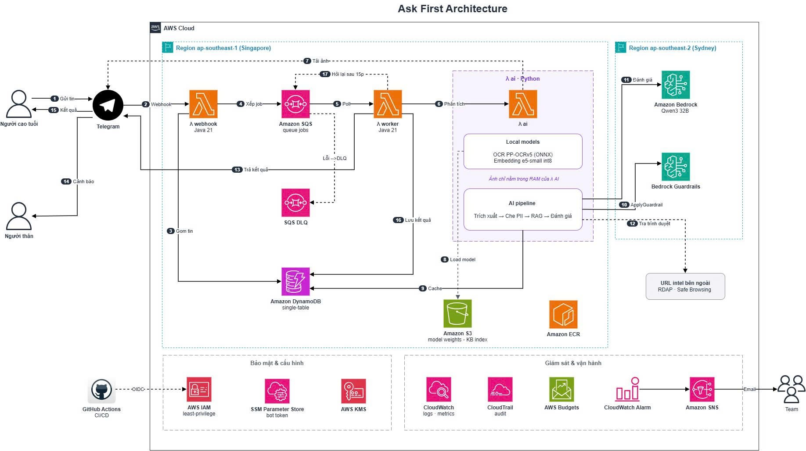

{}
**Draft note:** Figures marked as estimates are planning values. Verify prices and quotas in the AWS Pricing Calculator and the service pages before final submission.
{}

# AskFirst — "Ask Before You Transfer"
## A Serverless Telegram Assistant on AWS That Helps Older Adults Check Suspicious Messages

### 1. Executive Summary
AskFirst is a Telegram assistant for older adults and their families. Before transferring money, a user forwards a suspicious message, screenshot, or link to the bot. AskFirst reads the content, masks personal data, compares it with known scam patterns, asks a language model on Amazon Bedrock to assess the risk, and replies in simple Vietnamese. For high-risk cases, and only with consent, it can also alert a family member.

The system is fully serverless. Two Java 21 Lambda functions handle the Telegram webhook and the processing queue, a Python Lambda runs the AI pipeline, and Amazon SQS, Amazon DynamoDB, and Amazon S3 provide queuing, storage, and model hosting. The core stack runs in ap-southeast-1 (Singapore); the language model and guardrails are called in ap-southeast-2 (Sydney).

### 2. Problem Statement
#### What's the Problem?
Online fraud in Vietnam increasingly targets older adults through impersonation, fake investment offers, and malicious links. Victims often decide within minutes, alone, and under pressure. Existing protections (bank warnings, public awareness campaigns) arrive too late or are not available at the moment of decision. Older adults also tend to avoid installing new apps.

#### The Solution
AskFirst meets people where they already communicate: Telegram. The user sends the suspicious content to the bot and receives a clear verdict (low, medium, or high risk), the reasons, and a recommended next step. Processing follows this path:

1. A webhook Lambda authenticates Telegram requests, removes duplicate updates, rejects oversized media, and buffers messages.
2. Amazon SQS queues analysis jobs; failed jobs are retried up to five times and then moved to a dead-letter queue.
3. A worker Lambda groups a user's messages in a short window and calls the AI Lambda.
4. The AI Lambda extracts text (including OCR on images), masks personal data, retrieves similar scam knowledge, and asks Amazon Bedrock for an evaluation, with Bedrock Guardrails applied.
5. The worker returns the result to the user, stores it in DynamoDB, alerts family members when appropriate, and schedules a follow-up question after 15 minutes.

#### Benefits and Return on Investment
- **Protection at the moment of decision:** a check takes seconds and needs no new app.
- **Privacy by design:** personal data is masked before leaving the AI Lambda, and uploaded images are kept in memory only.
- **Low cost at pilot scale:** pay-per-use services mean cost grows with usage; the estimate in section 6 is designed to stay small.
- **Reusable foundation:** the same pipeline can later serve other channels or additional scam knowledge sources.

### 3. Solution Architecture
The architecture below shows the 17-step flow from the user's message to the result, together with security, monitoring, and CI/CD components.

#### AWS Services Used
| Service | Role in AskFirst |
| --- | --- |
| AWS Lambda (Java 21) — webhook | Receives Telegram webhooks, validates the secret, de-duplicates updates, guards media size, buffers messages |
| Amazon SQS + DLQ | Queues analysis jobs; retries failed jobs up to 5 times, then moves them to a dead-letter queue |
| AWS Lambda (Java 21) — worker | Polls the queue, groups messages, calls the AI Lambda, sends results and alerts |
| AWS Lambda (Python, container) — AI | OCR, personal-data masking, retrieval, and risk evaluation |
| Amazon ECR | Stores the AI Lambda container image |
| Amazon S3 | Stores model weights and the knowledge-base index |
| Amazon DynamoDB (single table) | Message buffer, sessions, check results, flags, alerts, and cache |
| Amazon Bedrock (Sydney) | Language model for risk evaluation |
| Amazon Bedrock Guardrails (Sydney) | Safety and sensitive-content controls on model input and output |
| AWS IAM, SSM Parameter Store, AWS KMS | Least-privilege access, bot-token storage, encryption |
| GitHub Actions with OIDC | CI/CD without long-lived AWS keys |
| Amazon CloudWatch, AWS CloudTrail, AWS Budgets, Amazon SNS | Logs, metrics, alarms, audit, cost alerts, and email notification to the team |

#### Component Design
- **Channel:** Telegram bot for the older adult and for family members.
- **Ingestion:** the webhook Lambda answers quickly; heavy work is deferred to the queue.
- **Processing:** the worker coordinates; the AI Lambda performs analysis; external lookups (domain registration data and web-safety checks) provide additional evidence.
- **Storage:** one DynamoDB table with access-pattern-driven keys; S3 holds models and the knowledge-base index only.
- **Safety:** consent before any family alert; personal data masked; guardrails on model calls.
- **Operations:** structured logs, alarms on queue depth and errors, budget alerts, and audit trail.

### 4. Technical Implementation
**Implementation Phases**
1. **Requirements and architecture (week 9):** problem definition, SRS, Region choice, repository and CI, DynamoDB model, SQS with DLQ.
2. **Webhook and worker (week 10):** Java 21 Lambdas, buffering, job types, retries, first dev deployment.
3. **AI pipeline and integration (week 11):** container image, models in S3, Bedrock and Guardrails, URL checks, cache, alerts, follow-up.
4. **Security, operations, and testing (week 12):** IAM, SSM, KMS, OIDC deployment, monitoring, end-to-end tests, cleanup.

**Technical Requirements**
- Java 21, Maven, AWS SAM CLI, Docker (and LocalStack for local runs), Python 3.x for the AI Lambda, and a GitHub repository with Actions.
- An AWS account with permission to create the resources above, and model access enabled in ap-southeast-2 for the chosen Bedrock model.
- A Telegram bot token created through BotFather.

### 5. Timeline & Milestones
| Weeks | Milestone |
| --- | --- |
| 1–8 | Learning phase: AWS foundations, operations, security, messaging, containers, CI/CD, and serverless patterns |
| 9 | Requirements, architecture, repository, SAM stack, DynamoDB model, SQS and DLQ |
| 10 | Webhook and worker Lambdas deployed to the dev stack |
| 11 | AI Lambda integrated end to end, with follow-up and family alerts |
| 12 | Hardening, monitoring, end-to-end tests, cleanup, final report |

### 6. Budget Estimation
{}
These numbers are **planning estimates** under stated assumptions, not quotes. Rebuild them in the [AWS Pricing Calculator](https://calculator.aws/) with current prices, and confirm the Bedrock model's availability and price in Sydney.
{}

**Assumptions (pilot):** about 300 users, 3,000 checks per month, roughly 1,500 input tokens and 400 output tokens per check, and AI Lambda runs of about 20 seconds with 3 GB of memory.

| Item | Cost driver | Estimate |
| --- | --- | --- |
| AWS Lambda (3 functions) | Requests and GB-seconds | Likely within free tier at pilot scale |
| Amazon SQS | Requests | Negligible |
| Amazon DynamoDB (on-demand) | Reads/writes, small storage | Under about 1 USD |
| Amazon S3 | A few GB of models and index | Under about 1 USD |
| Amazon ECR | Container image storage | Under about 1 USD |
| Amazon Bedrock | About 4.5M input and 1.2M output tokens per month | TBD — multiply by the current per-million-token price for the chosen model |
| Bedrock Guardrails | Text units processed | TBD — check current guardrail pricing |
| AWS KMS | Customer-managed keys | About 1 USD per key per month |
| CloudWatch Logs and alarms | Ingested logs, alarms | About 1–3 USD |
| SNS, CloudTrail (management events), Budgets | Mostly free at this scale | Negligible |

**Overall target:** keep the pilot within a single-digit USD monthly budget, excluding the model cost until the Bedrock price is confirmed. AWS Budgets alerts are configured to catch any deviation early.

### 7. Risk Assessment
#### Risk Matrix
| Risk | Impact | Probability |
| --- | --- | --- |
| Incorrect verdict (false negative or false positive) | High | Medium |
| Leakage of personal data | High | Low |
| Bedrock cross-Region latency or throttling | Medium | Medium |
| Cold start of the AI Lambda | Medium | High |
| Cost overrun from unexpected traffic | Medium | Low |
| Telegram API or external lookup unavailable | Medium | Medium |

#### Mitigation Strategies
- **Verdict quality:** ground the model with retrieved scam knowledge, return risk levels with reasons, and always advise confirming with family or the bank.
- **Privacy:** mask personal data before model calls, keep images in memory only, record consent, and apply guardrails.
- **Latency:** set timeouts, retry with backoff, and cache repeated URL checks.
- **Cold start:** keep the container lean and load models once per execution environment.
- **Cost:** budget alerts, log retention limits, and media-size limits before any job is queued.
- **Dependencies:** treat external lookups as optional evidence and degrade gracefully.

#### Contingency Plans
- Replay messages from the dead-letter queue after fixing a defect.
- Disable the Telegram webhook to stop traffic immediately if abuse or cost spikes occur.
- Roll back by redeploying the previous version of the stack.

### 8. Expected Outcomes
#### Technical Improvements
A working, documented, serverless pipeline from Telegram message to risk verdict, deployed with keyless CI/CD and monitored with alarms and budgets.

#### Long-term Value
A reusable anti-fraud foundation that can be extended with more scam knowledge, more channels, and agent-style capabilities as the project grows.
