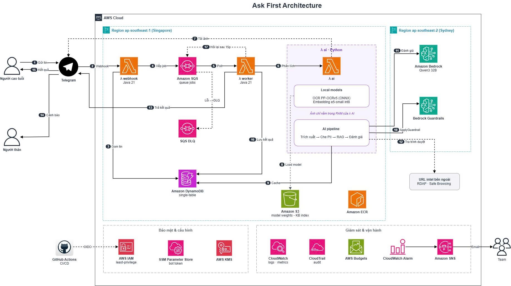

{}
**Lưu ý bản nháp:** Các con số ghi là ước tính chỉ là giá trị lập kế hoạch. Hãy kiểm tra lại giá và quota trong AWS Pricing Calculator và trang dịch vụ trước khi nộp bản cuối.
{}

# AskFirst — "Hỏi Trước Khi Chuyển"
## Trợ lý Telegram serverless trên AWS giúp người cao tuổi kiểm tra tin nhắn đáng ngờ

### 1. Tóm tắt điều hành
AskFirst là trợ lý Telegram dành cho người cao tuổi và gia đình. Trước khi chuyển tiền, người dùng chuyển tiếp tin nhắn, ảnh chụp màn hình hoặc đường link đáng ngờ cho bot. AskFirst đọc nội dung, che dữ liệu cá nhân, đối chiếu với các mẫu lừa đảo đã biết, nhờ một mô hình ngôn ngữ trên Amazon Bedrock đánh giá rủi ro và trả lời bằng tiếng Việt đơn giản. Với trường hợp rủi ro cao, và chỉ khi có sự đồng ý, bot còn có thể cảnh báo một người thân.

Hệ thống hoàn toàn serverless. Hai Lambda Java 21 xử lý webhook Telegram và hàng đợi, một Lambda Python chạy pipeline AI, còn Amazon SQS, Amazon DynamoDB và Amazon S3 đảm nhiệm hàng đợi, lưu trữ và chứa mô hình. Phần lõi chạy ở ap-southeast-1 (Singapore); mô hình ngôn ngữ và guardrails được gọi ở ap-southeast-2 (Sydney).

### 2. Tuyên bố vấn đề
#### Vấn đề hiện tại
Lừa đảo trực tuyến tại Việt Nam ngày càng nhắm vào người cao tuổi bằng các chiêu mạo danh, mời đầu tư giả và đường link độc hại. Nạn nhân thường quyết định trong vài phút, một mình và dưới áp lực. Các biện pháp bảo vệ hiện có (cảnh báo của ngân hàng, tuyên truyền) hoặc đến quá muộn, hoặc không có mặt đúng lúc cần quyết định. Người cao tuổi cũng thường ngại cài thêm ứng dụng mới.

#### Giải pháp
AskFirst đến với người dùng ở nơi họ vốn đã trò chuyện: Telegram. Người dùng gửi nội dung đáng ngờ cho bot và nhận được kết luận rõ ràng (rủi ro thấp, trung bình hoặc cao), lý do và bước nên làm tiếp theo. Luồng xử lý như sau:

1. Webhook Lambda xác thực yêu cầu từ Telegram, loại bỏ update trùng, chặn media quá lớn và gom tin nhắn.
2. Amazon SQS xếp hàng các job phân tích; job lỗi được thử lại tối đa năm lần rồi chuyển sang dead-letter queue.
3. Worker Lambda gom tin nhắn của một người dùng trong một khoảng ngắn rồi gọi Lambda AI.
4. Lambda AI trích xuất văn bản (gồm OCR trên ảnh), che dữ liệu cá nhân, truy xuất tri thức lừa đảo tương tự và nhờ Amazon Bedrock đánh giá, có áp dụng Bedrock Guardrails.
5. Worker trả kết quả cho người dùng, lưu vào DynamoDB, cảnh báo người thân khi phù hợp và đặt lịch hỏi lại sau 15 phút.

#### Lợi ích và hoàn vốn đầu tư (ROI)
- **Bảo vệ đúng lúc cần quyết định:** một lần kiểm tra mất vài giây và không cần cài ứng dụng mới.
- **Quyền riêng tư từ thiết kế:** dữ liệu cá nhân được che trước khi rời Lambda AI, ảnh tải lên chỉ nằm trong bộ nhớ.
- **Chi phí thấp ở quy mô thử nghiệm:** dịch vụ trả theo mức dùng nên chi phí tăng theo lượng sử dụng; ước tính ở mục 6 được thiết kế để ở mức nhỏ.
- **Nền tảng tái sử dụng:** cùng pipeline có thể phục vụ kênh khác hoặc thêm nguồn tri thức lừa đảo về sau.

### 3. Kiến trúc giải pháp
Sơ đồ dưới đây thể hiện luồng 17 bước từ tin nhắn của người dùng đến kết quả, cùng các thành phần bảo mật, giám sát và CI/CD.

#### Dịch vụ AWS sử dụng
| Dịch vụ | Vai trò trong AskFirst |
| --- | --- |
| AWS Lambda (Java 21) — webhook | Nhận webhook Telegram, kiểm tra secret, chống trùng update, chặn media quá lớn, gom tin nhắn |
| Amazon SQS + DLQ | Xếp hàng job phân tích; thử lại job lỗi tối đa 5 lần rồi chuyển vào dead-letter queue |
| AWS Lambda (Java 21) — worker | Poll hàng đợi, gom tin nhắn, gọi Lambda AI, gửi kết quả và cảnh báo |
| AWS Lambda (Python, container) — AI | OCR, che dữ liệu cá nhân, truy xuất và đánh giá rủi ro |
| Amazon ECR | Lưu container image của Lambda AI |
| Amazon S3 | Lưu trọng số mô hình và chỉ mục knowledge base |
| Amazon DynamoDB (single table) | Buffer tin nhắn, phiên, kết quả kiểm tra, cờ, cảnh báo và cache |
| Amazon Bedrock (Sydney) | Mô hình ngôn ngữ để đánh giá rủi ro |
| Amazon Bedrock Guardrails (Sydney) | Kiểm soát an toàn và nội dung nhạy cảm cho đầu vào/đầu ra của mô hình |
| AWS IAM, SSM Parameter Store, AWS KMS | Quyền tối thiểu, lưu bot token, mã hóa |
| GitHub Actions với OIDC | CI/CD không dùng khóa AWS dài hạn |
| Amazon CloudWatch, AWS CloudTrail, AWS Budgets, Amazon SNS | Log, metric, alarm, kiểm toán, cảnh báo chi phí và gửi email cho nhóm |

#### Thiết kế thành phần
- **Kênh:** bot Telegram cho người cao tuổi và người thân.
- **Tiếp nhận:** webhook Lambda phản hồi nhanh; việc nặng được chuyển sang hàng đợi.
- **Xử lý:** worker điều phối; Lambda AI thực hiện phân tích; tra cứu bên ngoài (dữ liệu đăng ký tên miền và kiểm tra an toàn web) bổ sung bằng chứng.
- **Lưu trữ:** một bảng DynamoDB với key thiết kế theo access pattern; S3 chỉ chứa mô hình và chỉ mục knowledge base.
- **An toàn:** có sự đồng ý trước khi cảnh báo người thân; dữ liệu cá nhân được che; guardrails cho lời gọi mô hình.
- **Vận hành:** log có cấu trúc, alarm cho độ sâu hàng đợi và lỗi, cảnh báo ngân sách và nhật ký kiểm toán.

### 4. Triển khai kỹ thuật
**Các giai đoạn triển khai**
1. **Yêu cầu và kiến trúc (tuần 9):** xác định bài toán, SRS, chọn Region, repository và CI, mô hình DynamoDB, SQS kèm DLQ.
2. **Webhook và worker (tuần 10):** Lambda Java 21, gom tin, các loại job, retry, triển khai dev lần đầu.
3. **Pipeline AI và tích hợp (tuần 11):** container image, mô hình trong S3, Bedrock và Guardrails, kiểm tra URL, cache, cảnh báo, hỏi lại.
4. **Bảo mật, vận hành và kiểm thử (tuần 12):** IAM, SSM, KMS, triển khai OIDC, giám sát, kiểm thử end-to-end, dọn dẹp.

**Yêu cầu kỹ thuật**
- Java 21, Maven, AWS SAM CLI, Docker (và LocalStack để chạy local), Python 3.x cho Lambda AI, và repository GitHub có Actions.
- Tài khoản AWS có quyền tạo các tài nguyên trên, và đã bật quyền truy cập mô hình ở ap-southeast-2 cho mô hình Bedrock được chọn.
- Bot token Telegram được tạo qua BotFather.

### 5. Lộ trình & Mốc triển khai
| Tuần | Mốc |
| --- | --- |
| 1–8 | Giai đoạn học: nền tảng AWS, vận hành, bảo mật, nhắn tin, container, CI/CD và các mẫu serverless |
| 9 | Yêu cầu, kiến trúc, repository, stack SAM, mô hình DynamoDB, SQS và DLQ |
| 10 | Webhook và worker Lambda được triển khai lên stack dev |
| 11 | Lambda AI tích hợp end-to-end, có hỏi lại và cảnh báo người thân |
| 12 | Củng cố, giám sát, kiểm thử end-to-end, dọn dẹp, báo cáo cuối |

### 6. Ước tính ngân sách
{}
Các con số dưới đây là **ước tính để lập kế hoạch** theo giả định nêu rõ, không phải báo giá. Hãy dựng lại trong [AWS Pricing Calculator](https://calculator.aws/) với giá hiện hành và xác nhận mô hình Bedrock có sẵn và giá ở Sydney.
{}

**Giả định (thử nghiệm):** khoảng 300 người dùng, 3.000 lượt kiểm tra mỗi tháng, mỗi lượt khoảng 1.500 token đầu vào và 400 token đầu ra, Lambda AI chạy khoảng 20 giây với 3 GB bộ nhớ.

| Hạng mục | Yếu tố chi phí | Ước tính |
| --- | --- | --- |
| AWS Lambda (3 function) | Số request và GB-giây | Nhiều khả năng nằm trong free tier ở quy mô thử nghiệm |
| Amazon SQS | Số request | Không đáng kể |
| Amazon DynamoDB (on-demand) | Đọc/ghi, dung lượng nhỏ | Dưới khoảng 1 USD |
| Amazon S3 | Vài GB mô hình và chỉ mục | Dưới khoảng 1 USD |
| Amazon ECR | Dung lượng container image | Dưới khoảng 1 USD |
| Amazon Bedrock | Khoảng 4,5 triệu token đầu vào và 1,2 triệu token đầu ra mỗi tháng | TBD — nhân với giá mỗi triệu token hiện hành của mô hình được chọn |
| Bedrock Guardrails | Số text unit được xử lý | TBD — kiểm tra giá guardrail hiện hành |
| AWS KMS | Khóa do khách hàng quản lý | Khoảng 1 USD mỗi khóa mỗi tháng |
| CloudWatch Logs và alarm | Log tiếp nhận, alarm | Khoảng 1–3 USD |
| SNS, CloudTrail (management events), Budgets | Phần lớn miễn phí ở quy mô này | Không đáng kể |

**Mục tiêu chung:** giữ chi phí thử nghiệm trong ngưỡng một chữ số USD mỗi tháng, chưa tính chi phí mô hình cho đến khi xác nhận giá Bedrock. Cảnh báo AWS Budgets được cấu hình để phát hiện sớm mọi sai lệch.

### 7. Đánh giá rủi ro
#### Ma trận rủi ro
| Rủi ro | Ảnh hưởng | Xác suất |
| --- | --- | --- |
| Kết luận sai (bỏ sót hoặc báo nhầm) | Cao | Trung bình |
| Rò rỉ dữ liệu cá nhân | Cao | Thấp |
| Độ trễ hoặc throttling của Bedrock giữa các Region | Trung bình | Trung bình |
| Cold start của Lambda AI | Trung bình | Cao |
| Vượt chi phí do lưu lượng bất thường | Trung bình | Thấp |
| Telegram API hoặc nguồn tra cứu bên ngoài không khả dụng | Trung bình | Trung bình |

#### Chiến lược giảm thiểu
- **Chất lượng kết luận:** làm căn cứ cho mô hình bằng tri thức lừa đảo truy xuất được, trả về mức rủi ro kèm lý do và luôn khuyên xác nhận với người thân hoặc ngân hàng.
- **Quyền riêng tư:** che dữ liệu cá nhân trước khi gọi mô hình, chỉ giữ ảnh trong bộ nhớ, ghi nhận sự đồng ý và áp dụng guardrails.
- **Độ trễ:** đặt timeout, retry có backoff và cache các lần kiểm tra URL lặp lại.
- **Cold start:** giữ container gọn và nạp mô hình một lần cho mỗi execution environment.
- **Chi phí:** cảnh báo ngân sách, giới hạn thời gian lưu log và giới hạn kích thước media trước khi tạo job.
- **Phụ thuộc bên ngoài:** coi tra cứu bên ngoài là bằng chứng tùy chọn và suy giảm êm khi lỗi.

#### Kế hoạch dự phòng
- Phát lại message từ dead-letter queue sau khi sửa lỗi.
- Tắt webhook Telegram để dừng lưu lượng ngay khi có lạm dụng hoặc chi phí tăng đột biến.
- Rollback bằng cách triển khai lại phiên bản stack trước đó.

### 8. Kết quả kỳ vọng
#### Cải tiến kỹ thuật
Một pipeline serverless hoạt động và có tài liệu, đi từ tin nhắn Telegram đến kết luận rủi ro, triển khai bằng CI/CD không dùng khóa và được giám sát bằng alarm và ngân sách.

#### Giá trị dài hạn
Một nền tảng chống lừa đảo có thể tái sử dụng, mở rộng thêm tri thức lừa đảo, thêm kênh và các khả năng kiểu agent khi dự án phát triển.
