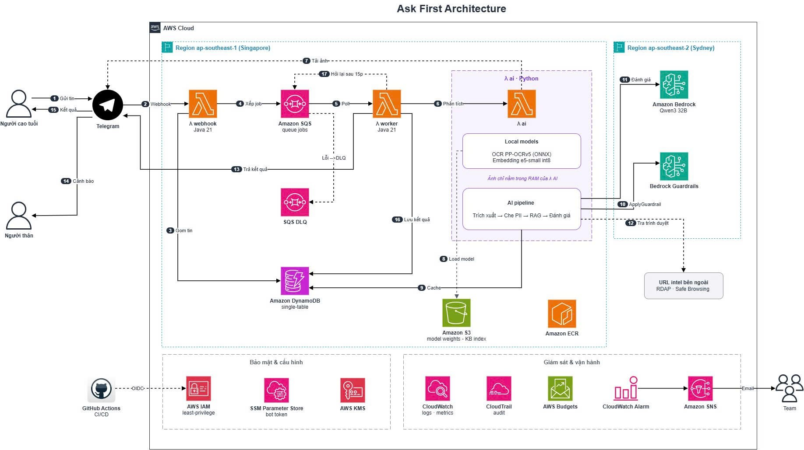

#### The 17-step flow

| Step | What happens |
| --- | --- |
| 1–2 | The user sends a message to the bot; Telegram calls the **webhook Lambda** |
| 3 | The webhook buffers the message in **DynamoDB** |
| 4–5 | The webhook queues a job in **SQS**; the **worker Lambda** polls it |
| 6 | The worker invokes the **AI Lambda** with the grouped messages |
| 7 | If an image was sent, the AI Lambda downloads it from Telegram into memory |
| 8 | The AI Lambda loads models and the knowledge-base index from **S3** (once per cold start) |
| 9 | Cached URL results are read from or written to DynamoDB |
| 10–11 | **Bedrock Guardrails** are applied, and the language model evaluates the content |
| 12 | Domain registration (RDAP) and web-safety lookups add evidence |
| 13 | The worker sends the result to Telegram |
| 14 | A high-risk result may alert a family member (with consent) |
| 15 | The older adult receives the verdict |
| 16 | The result is saved to DynamoDB |
| 17 | A follow-up job is queued with a 15-minute delay |
| Error path | A job that fails 5 times moves to the **dead-letter queue** |

#### Regions
+ **ap-southeast-1 (Singapore):** Lambda, SQS, DynamoDB, S3, ECR, monitoring.
+ **ap-southeast-2 (Sydney):** Amazon Bedrock model and guardrails.

#### Design decisions used in this workshop
+ **Single-table DynamoDB** with keys derived from access patterns.
+ **Images stay in memory** of the AI Lambda only; nothing is written to disk or S3.
+ **Lambdas run outside a VPC** so outbound calls to Telegram and public lookups need no NAT gateway (a cost saving; reconsider if your security requirements change).
+ **Infrastructure as code with AWS SAM**; one stack named `askfirst-dev`.

#### Estimated time and cost
+ About 8–10 hours end to end.
+ Cost should stay small under free-tier-friendly usage, but Bedrock, Guardrails, KMS, and CloudWatch are billable. See the [Proposal](../../2-Proposal/) for assumptions and clean up when finished.
