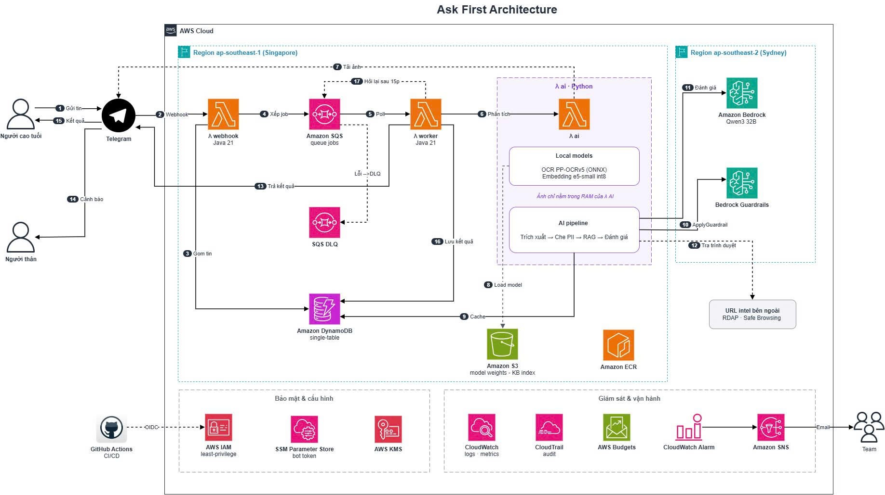

#### Luồng 17 bước

| Bước | Điều gì xảy ra |
| --- | --- |
| 1–2 | Người dùng nhắn cho bot; Telegram gọi **webhook Lambda** |
| 3 | Webhook gom tin nhắn vào **DynamoDB** |
| 4–5 | Webhook đưa job vào **SQS**; **worker Lambda** poll job |
| 6 | Worker gọi **Lambda AI** với các tin nhắn đã gom |
| 7 | Nếu có ảnh, Lambda AI tải ảnh từ Telegram vào bộ nhớ |
| 8 | Lambda AI nạp mô hình và chỉ mục knowledge base từ **S3** (một lần mỗi cold start) |
| 9 | Kết quả URL đã cache được đọc hoặc ghi vào DynamoDB |
| 10–11 | Áp dụng **Bedrock Guardrails**, rồi mô hình ngôn ngữ đánh giá nội dung |
| 12 | Tra cứu dữ liệu đăng ký tên miền (RDAP) và an toàn web để bổ sung bằng chứng |
| 13 | Worker gửi kết quả về Telegram |
| 14 | Kết quả rủi ro cao có thể cảnh báo người thân (khi có đồng ý) |
| 15 | Người cao tuổi nhận được kết luận |
| 16 | Kết quả được lưu vào DynamoDB |
| 17 | Một job hỏi lại được xếp hàng với độ trễ 15 phút |
| Nhánh lỗi | Job lỗi 5 lần sẽ chuyển sang **dead-letter queue** |

#### Region
+ **ap-southeast-1 (Singapore):** Lambda, SQS, DynamoDB, S3, ECR, giám sát.
+ **ap-southeast-2 (Sydney):** mô hình và guardrails của Amazon Bedrock.

#### Các quyết định thiết kế dùng trong workshop
+ **DynamoDB single-table** với key suy ra từ access pattern.
+ **Ảnh chỉ nằm trong bộ nhớ** của Lambda AI; không ghi ra đĩa hay S3.
+ **Lambda chạy ngoài VPC** để các lời gọi ra Telegram và tra cứu công khai không cần NAT gateway (tiết kiệm chi phí; hãy cân nhắc lại nếu yêu cầu bảo mật thay đổi).
+ **Hạ tầng dưới dạng mã với AWS SAM**; một stack tên `askfirst-dev`.

#### Thời gian và chi phí ước tính
+ Khoảng 8–10 giờ từ đầu đến cuối.
+ Chi phí nên nhỏ nếu dùng ở mức thân thiện free tier, nhưng Bedrock, Guardrails, KMS và CloudWatch vẫn tính phí. Xem [Proposal](../../2-Proposal/) để biết giả định và hãy dọn dẹp khi xong.
